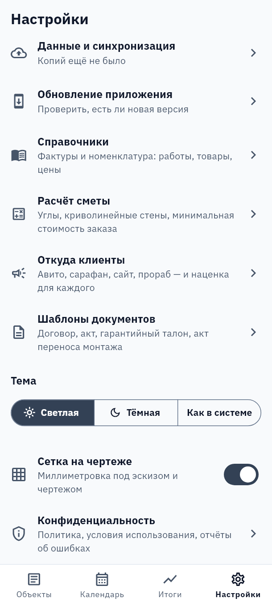
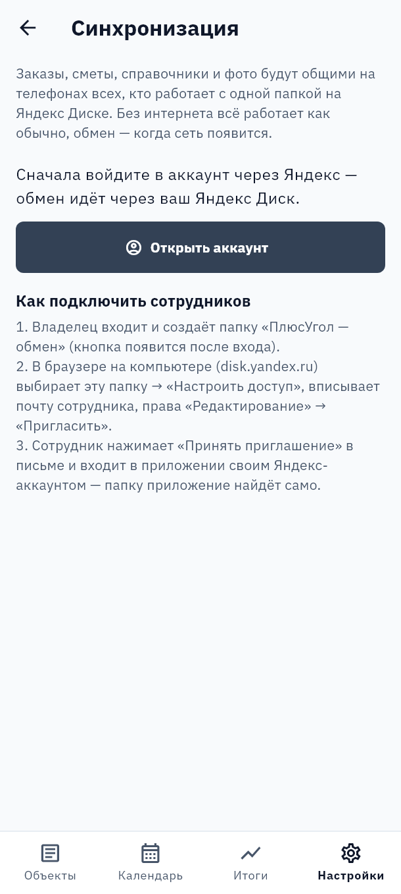
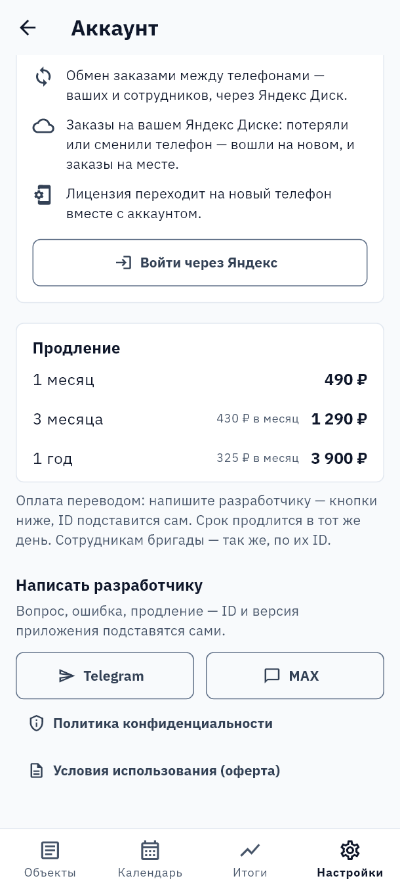
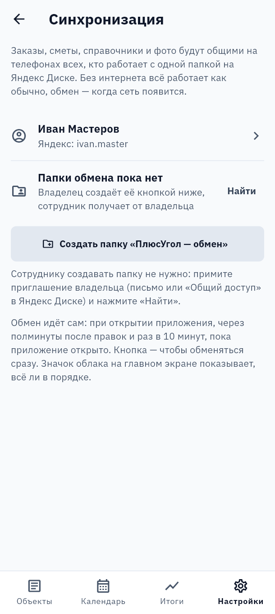
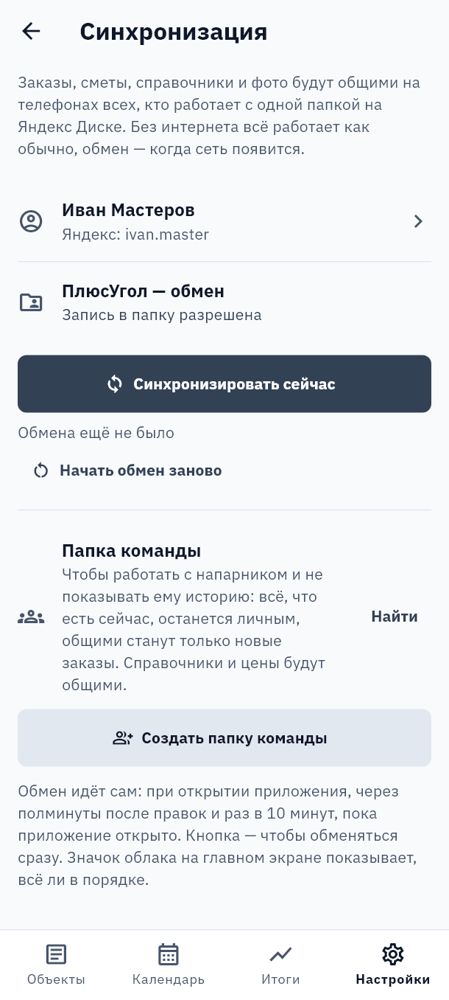
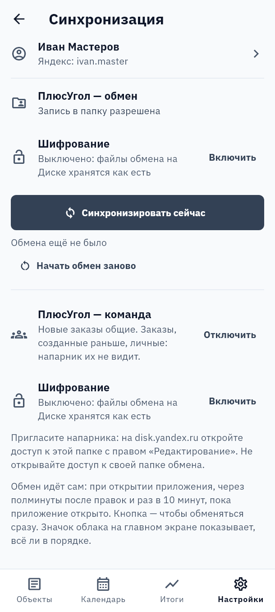
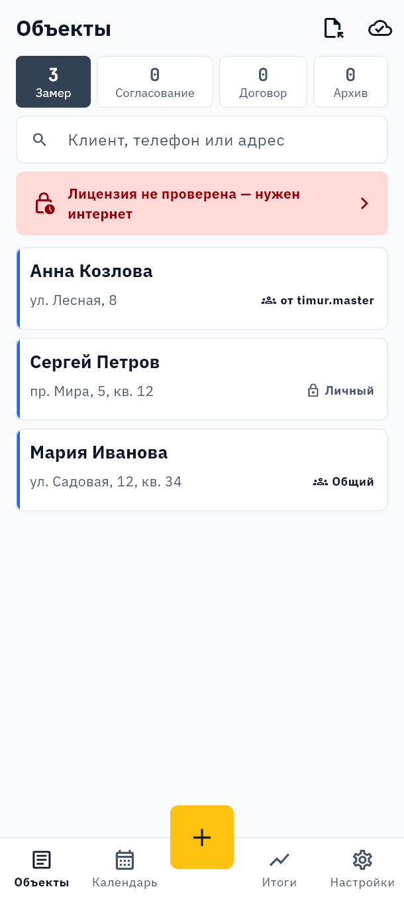

# Обмен заказами через Яндекс Диск

Заказы, сметы, справочники и фото становятся общими на телефонах всех, кто подключён к одной папке
на Яндекс Диске. Без интернета приложение работает как обычно, а обмен случится, когда сеть появится.

Что понадобится:

- аккаунт Яндекса с Диском — у каждого, кто будет обмениваться;
- владельцу один раз — компьютер с браузером, чтобы пригласить сотрудников;
- около 10 минут.

**Кто что делает**

| | |
| --- | --- |
| **Работаете один** | Только [часть 1](#часть-1-войти-и-создать-папку-обмена). Заказы будут храниться и на Диске: сменили телефон — вошли на новом, и всё на месте. Программа на компьютере входит тем же аккаунтом и работает вместе с телефоном. |
| **Вы владелец бригады** | [Часть 1](#часть-1-войти-и-создать-папку-обмена) у себя на телефоне, потом [часть 2](#часть-2-пригласить-сотрудников-в-папку) на компьютере. |
| **Вы сотрудник** | Дождитесь письма с приглашением от владельца и выполните [часть 3](#часть-3-принять-приглашение-и-подключиться). |
| **Работаете с напарником и не хотите показывать ему историю** | [Часть 1](#часть-1-войти-и-создать-папку-обмена) у каждого, потом [папка команды](#работа-с-напарником-без-показа-истории). |

---

## Часть 1. Войти и создать папку обмена

*Владелец, на телефоне.*

### 1. Откройте «Синхронизацию»

На нижней панели нажмите **«Настройки»**, затем **«Данные и синхронизация»** → **«Синхронизация»**.

### 2. Перейдите к входу

Пока вы не вошли, экран предлагает сначала войти. Нажмите **«Открыть аккаунт»**.

### 3. Войдите через Яндекс

В карточке **«Обмен и облако — по желанию»** нажмите **«Войти через Яндекс»**. Откроется окно Яндекса:

- выберите свой аккаунт или войдите в него;
- разрешите доступ: приложению нужен ваш Яндекс Диск и имя, чтобы показать, кто вошёл.

После входа вернитесь назад, в «Синхронизацию».

> Лицензия этого телефона при входе перейдёт на аккаунт. Заказы, которые уже есть в телефоне, никуда не денутся.

### 4. Создайте папку «ПлюсУгол — обмен»

Теперь на экране видно, кто вошёл, и строка **«Папки обмена пока нет»**. Нажмите
**«Создать папку «ПлюсУгол — обмен»»** — папка появится в корне Диска. Название у папки обмена одно для
всех и выбирать его не нужно: так она не перепутается с вашими папками.

### 5. Проверьте, что всё готово

Под названием папки должна быть синяя надпись **«Запись в папку разрешена»**. Первый обмен начнётся
сам: телефон отправит в папку все свои заказы.

Дальше обмен идёт без вас: при открытии приложения, через полминуты после правок и раз в 10 минут,
пока приложение открыто. Кнопка **«Синхронизировать сейчас»** нужна, только чтобы обменяться сразу.

---

## Часть 2. Пригласить сотрудников в папку

*Владелец, в браузере на компьютере.* Яндекс разрешает открывать доступ к папке только в браузере
на компьютере — в приложении Яндекс Диска и в «ПлюсУгол» этого сделать нельзя.

### 1. Откройте Диск

Зайдите на [disk.yandex.ru](https://disk.yandex.ru) под тем же аккаунтом, с которым вошли в
приложении. В списке файлов найдите папку **«ПлюсУгол — обмен»**.

### 2. Пригласите сотрудника

**Выделить «ПлюсУгол — обмен» → «Настроить доступ» → почта сотрудника → «Редактирование» → «Пригласить»**

- Выделите папку и нажмите **«Настроить доступ»** на верхней панели (или в меню по правой кнопке мыши).
- Впишите адрес почты сотрудника на Яндексе. Если аккаунта у него нет, Яндекс предложит зарегистрироваться.
- Выберите права **«Редактирование»** и нажмите **«Пригласить»**.

Повторите для каждого сотрудника.

> ⚠️ С правами **«Просмотр»** обмен работать не будет: телефон сотрудника не сможет записывать в
> папку, и приложение напишет «Нет права записи в папку». Нужны права «Редактирование».

---

## Часть 3. Принять приглашение и подключиться

*Сотрудник.*

### 1. Примите приглашение

На почту придёт письмо от Яндекс Диска. Нажмите в нём **«Принять приглашение»** — откроется Диск.
Там ещё раз нажмите **«Принять приглашение»** вверху экрана. После этого папка «ПлюсУгол — обмен» появится и
на вашем Диске.

> Общая папка занимает место только на Диске владельца. Но совсем без свободного места на вашем
> Диске записывать в неё не получится — оставьте хотя бы немного.

### 2. Войдите в приложении своим аккаунтом

Как в части 1: **«Настройки»** → **«Данные и синхронизация»** → **«Синхронизация»** → **«Открыть аккаунт»** → **«Войти через Яндекс»**.
Входите тем аккаунтом, на почту которого пришло приглашение.

### 3. Вернитесь в «Синхронизацию»

Общую папку владельца приложение найдёт само — выбирать ничего не нужно. На экране появится папка
**«ПлюсУгол — обмен»** и надпись **«Запись в папку разрешена»**, начнётся первый обмен: к вам придут заказы
бригады, от вас — ваши.

> ⚠️ Если на экране **«Папки обмена пока нет»** — приглашение ещё не принято. Не нажимайте
> «Создать папку»: получится своя отдельная папка, и обмена с бригадой не будет. Вернитесь к шагу 1,
> примите приглашение и нажмите **«Найти»**.

---

## Что становится общим

В папке **«ПлюсУгол — обмен»** общее всё: все заказы всех, кто к ней подключён, с телефонами заказчиков,
оплатами и себестоимостью, справочники, карточка компании и шаблоны договора. Это подходит для себя
(телефон и компьютер) и для сотрудников бригады. Выбрать часть заказов здесь нельзя: для этого есть
[папка команды](#работа-с-напарником-без-показа-истории).

В «Итогах» при чужих заказах появляется переключатель **«Мои заказы / Все заказы»**. Заказ считается
вашим, если создан на вашем телефоне или компьютере. Если старый заказ последним правил другой
участник, он может оказаться у него.

## Работа с напарником без показа истории

Если вы работаете с самостоятельным мастером и не хотите показывать ему прошлые заказы, не приглашайте
его в свою папку обмена. Для этого есть отдельная **папка команды** (с версии 0.1.9).

| Папка | Кто в ней | Что в ней |
| --- | --- | --- |
| **«ПлюсУгол — обмен»** | только ваши устройства | все ваши заказы |
| **«ПлюсУгол — команда»** | вы и напарник | общие заказы, справочники и цены |

### Как подключить

1. Оба настраивают свою папку обмена ([часть 1](#часть-1-войти-и-создать-папку-обмена)) и ставят новую
   версию приложения.
2. Один нажимает в «Синхронизации» **«Создать папку команды»**.
3. Он открывает на [disk.yandex.ru](https://disk.yandex.ru) доступ к папке **«ПлюсУгол — команда»** второму
   с правом «Редактирование». Второй принимает приглашение и открывает «Синхронизацию»: приложение
   подключится само. На компьютере того же аккаунта тоже откройте этот экран.

> ⚠️ Приглашайте напарника только в папку команды. Если открыть ему доступ к «ПлюсУгол — обмен», он увидит
> всю вашу историю.

### Какие заказы общие, а какие личные

| Заказ | Что с ним будет |
| --- | --- |
| Создан до подключения папки команды | **личный**, напарник его не видит |
| Создан после подключения | **общий**, уходит напарнику |
| Копия заказа | такой же, как исходный |

У напарника работает то же самое: его история остаётся у него.

На экране заказа есть переключатель **«Общий заказ»**. Его видит только автор заказа.

- **Сделать личный заказ общим:** он уйдёт напарнику целиком, с заказчиком, сметой, оплатами, расходами и фото.
- **Оставить новый заказ личным:** выключите переключатель сразу, в первые полминуты, пока не прошёл обмен.
- **Сделать общий заказ личным:** ваши новые правки к напарнику не пойдут.

> ⚠️ Отправленное не вернуть: то, что уже ушло напарнику, останется у него, даже если сделать заказ личным.
> Если напарник поправит свою копию, его правка всё равно придёт к вам.

Общий заказ редактируют оба. Если кто-то из вас его удалит, он исчезнет у обоих.

### Отметка на карточке заказа

С версии 0.1.10 на карточке в списке заказов, справа под суммой, видно, чей это заказ. Отметка есть только
при подключённой папке команды.

| Отметка | Что значит |
| --- | --- |
| **Общий** | ваш заказ, напарник его видит |
| **от логин** | заказ напарника, подписан его логином Яндекса |
| **Личный** | виден только вам |

### Что ещё общее

- Справочники, цены с себестоимостью и учёт углов общие. Карточка компании и шаблоны договора у каждого свои.
- Своя папка обмена работает как раньше и хранит все ваши заказы. Чужие общие заказы приходят из папки команды.
- В «Итогах» переключатель **«Мои заказы / Все заказы»**: заказы напарника попадают только во «Все заказы».

## Шифрование папки паролем

Можно сделать так, чтобы на Диске лежали только зашифрованные файлы: ни Яндекс, ни тот, кто получит
доступ к Диску, не прочтёт ни заказов, ни паспортов клиентов, ни фото.

1. Обновите приложение на **всех** телефонах и ПК, которые обмениваются через эту папку.
2. В «Синхронизации» у папки — строка **«Шифрование»** → **«Включить»**. Придумайте пароль не короче
   8 знаков и введите его дважды.
3. На остальных устройствах появится **«Ввести пароль»**, а на главном экране — красный замок. Пока
   пароль не введён, обмен с этой папкой стоит. Введите тот же пароль — обмен продолжится.

Шифруется каждая папка отдельно: своя папка обмена и папка команды могут иметь разные пароли.
Пароль напарнику передайте лично, не через Диск. Ни пароля, ни ключа на Диске нет: забудете пароль —
данные обмена на Диске не восстановить. Заказы в телефонах при этом останутся.

## Значок облака на главном экране

После настройки справа вверху на экране «Объекты» появится облако. Оно показывает, как прошёл обмен; нажмите на
него, чтобы открыть «Синхронизацию».

| Значок | Что значит |
| --- | --- |
| Облако с галочкой | Всё в порядке, обмен прошёл |
| Облако со стрелками | Идёт обмен |
| Перечёркнутое облако | Нет интернета — обменяется, когда появится сеть |
| Красный значок | Обмен не удался — откройте «Синхронизацию», там написано, что не так |
| Красный замок | Папку зашифровали на другом устройстве — откройте «Синхронизацию» и введите пароль |

## Если что-то не так

| Сообщение | Что делать |
| --- | --- |
| «У аккаунта нет Яндекс Диска» | Аккаунт создан по номеру телефона (например, через Яндекс Go или Еду) — у таких нет Диска. Откройте [disk.yandex.ru](https://disk.yandex.ru) в браузере под этим аккаунтом, завершите регистрацию (придумайте логин или пароль) и войдите в приложении снова. |
| «Нет права записи в папку» | Владелец дал права «Просмотр». Пусть на disk.yandex.ru выделит папку, нажмёт «Настроить доступ» и поменяет вам права на «Редактирование». |
| «Папки нет на Диске» | Владелец закрыл доступ или удалил папку. Попросите владельца пригласить вас снова и примите приглашение — приложение найдёт папку само. Если папку просто переименовали, приложение тоже найдёт её само. |
| «Вход в Яндекс устарел» | Откройте «Синхронизацию» → «Открыть аккаунт» и войдите через Яндекс ещё раз. |
| Чьих-то заказов не видно | Проверьте значок облака у обоих: он должен быть с галочкой. Нажмите «Синхронизировать сейчас» сначала на телефоне, где заказ создан, потом на своём. Если не помогло — «Начать обмен заново»: телефон заново отправит и примет все данные, ничего не удаляется. |
| Сотрудник ушёл из бригады | На disk.yandex.ru выделите папку «ПлюсУгол — обмен» → «Настроить доступ» и уберите его. Новые заказы к нему больше не попадут. То, что уже было у него в телефоне, там и останется. |

---

Подробнее о доступе к папкам — в справке Яндекса:
[Настроить общую папку](https://yandex.ru/support/disk/share/shared-folders.html) и
[Меня пригласили в общую папку](https://yandex.ru/support/disk/share/shared-folders-to-me.html).

Инструкция для версии ПлюсУгол 0.1.5 и новее. Папка команды — с версии 0.1.9, отметка на карточке — с 0.1.10,
шифрование — с 0.1.17.

## Правила лицензии

- Одна лицензия (один Яндекс-аккаунт) работает на **одном основном телефоне и одном основном компьютере** одновременно.
- Основное устройство меняют в «Аккаунте» кнопкой «Сделать основным» — **не чаще раза в неделю**.
- На неосновном устройстве программа закрыта: открыт только «Аккаунт» (сделать основным, выйти, ID). Заказы на нём не удаляются.
- Каждому сотруднику и напарнику — свой аккаунт и своя лицензия; общие заказы — через папку обмена или папку команды.
